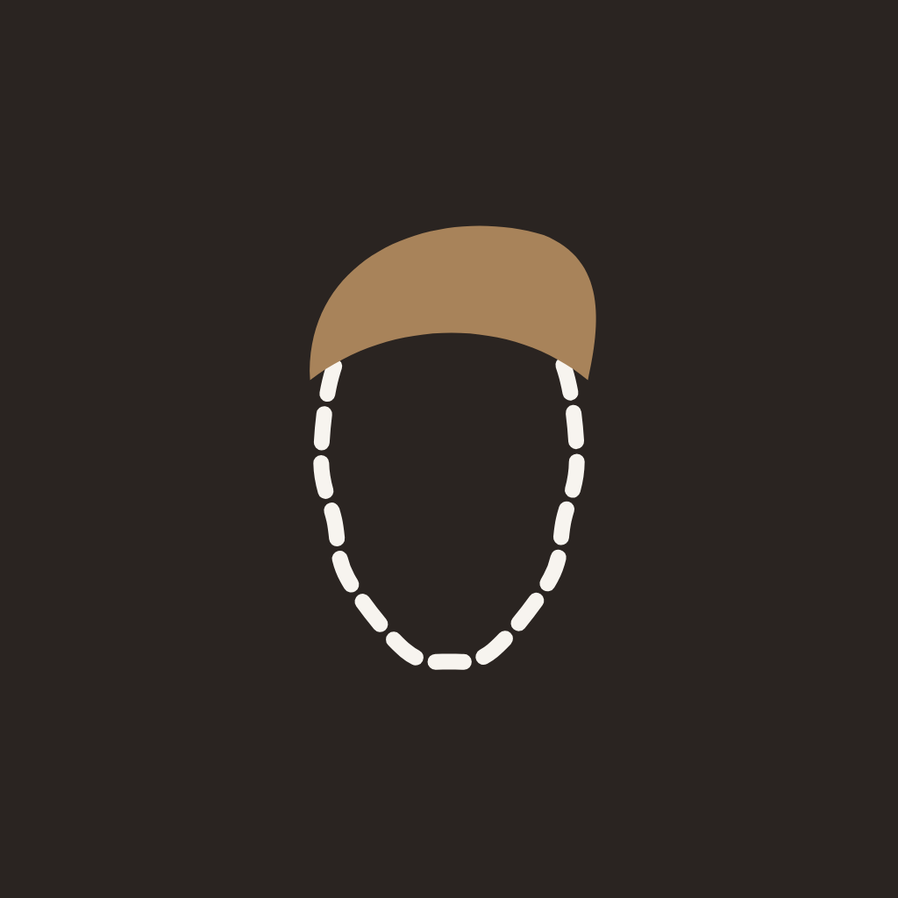
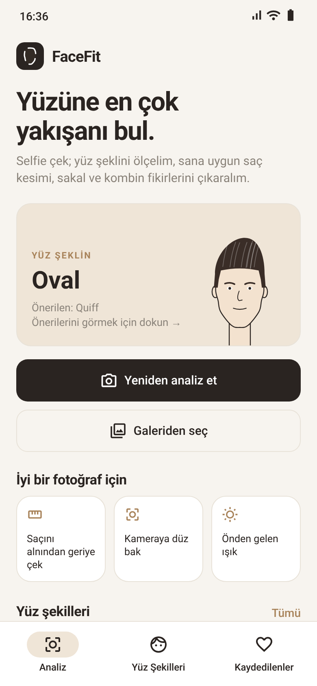
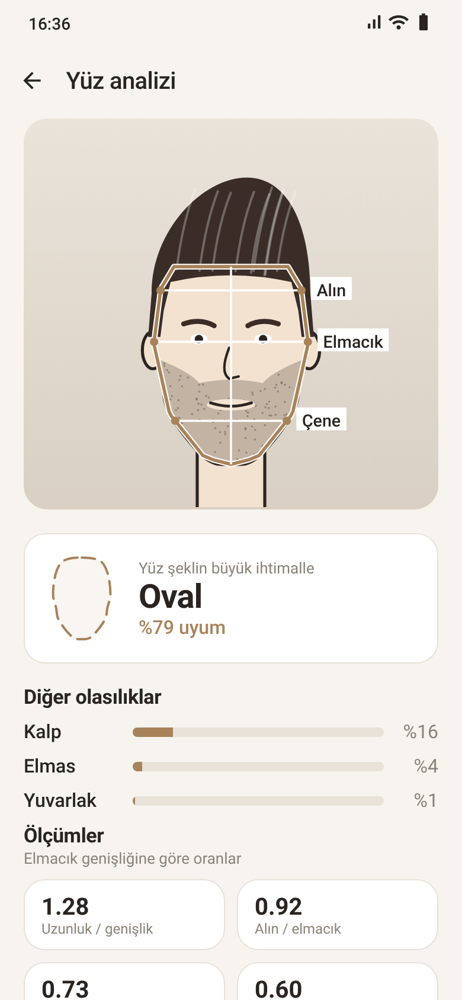
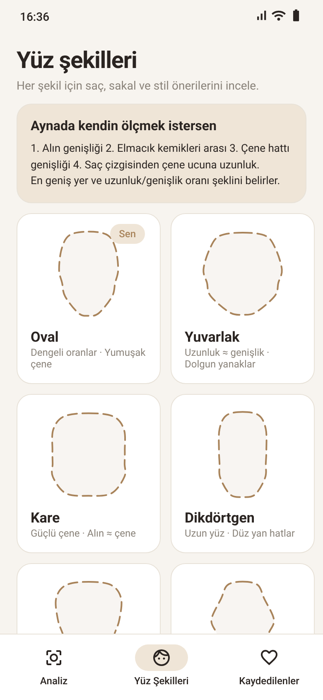
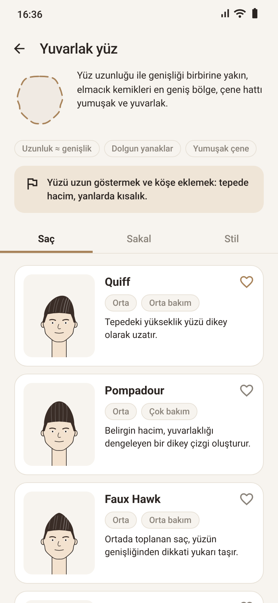
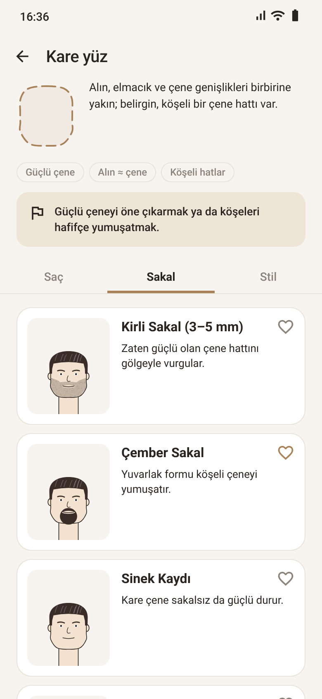
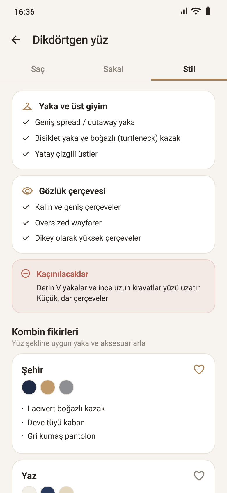
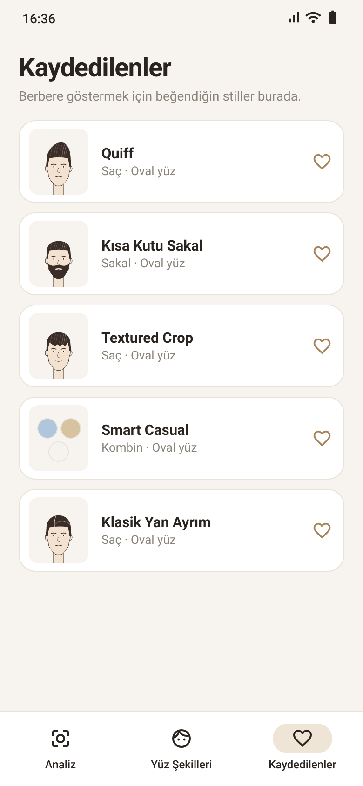

<p align="center">
  
</p>

<h1 align="center">FaceFit</h1>
<p align="center">Selfie'den yüz şeklini tahmin eden, yüz şekline göre <b>saç kesimi</b>, <b>sakal</b> ve <b>kombin</b> önerileri sunan Flutter uygulaması.</p>

<p align="center">
  
  
  
  
</p>

---

## Ekran görüntüleri

| Ana sayfa | Yüz analizi | Yüz şekilleri |
|:---:|:---:|:---:|
|  |  |  |

| Saç önerileri | Sakal önerileri | Stil ve kombinler | Kaydedilenler |
|:---:|:---:|:---:|:---:|
|  |  |  |  |

> Analiz ekranındaki yüz, örnek olarak çizilmiş bir portredir; uygulamada kendi fotoğrafın ve onun üzerine çizilen yüz hattı görünür.

## Özellikler

- **Fotoğraftan yüz şekli tahmini** – Kamerayla selfie çek ya da galeriden seç. Google ML Kit yüz hattını (36 nokta) bulur; alın, elmacık, çene genişlikleri ve yüz uzunluğu ölçülür.
- **6 yüz şekli** – Oval, Yuvarlak, Kare, Dikdörtgen, Kalp, Elmas. Sonuç olasılıklarla gösterilir (ör. "Oval %79, Kalp %16").
- **Saç kesimi önerileri** – Her yüz şekli için 5–6 kesim, neden uyduğu, uzunluk ve bakım etiketi, kaçınılacak kesimler.
- **Sakal önerileri** – Kirli sakal, kutu sakal, keçi, çember, çapa, çene hattı… her biri yüz şekline göre açıklamalı.
- **Stil rehberi** – Yaka tipi, gözlük çerçevesi, şapka önerileri ve renk paletli kombin fikirleri.
- **Çizilmiş portreler** – Tüm saç ve sakal örnekleri, seçilen yüz şekli üzerinde kodla (CustomPainter) çizilir; görsel dosyası gerekmez.
- **Kaydedilenler** – Beğendiğin stilleri kalple kaydet, berbere gösterirken hızlıca aç.
- **Şekli elle seçme** – Tahmin sana uymadıysa yüz şeklini kendin seçebilirsin.
- **Çevrimdışı** – Analiz cihazda yapılır, fotoğraf hiçbir yere gönderilmez.

## Yüz şekli nasıl tahmin ediliyor?

1. ML Kit, fotoğraftaki en büyük yüzün kontur noktalarını verir.
2. Baş eğikse kontur, alın–çene ekseni dikey olacak şekilde döndürülür.
3. Dört oran hesaplanır (hepsi elmacık genişliğine göre):
   - Uzunluk / genişlik
   - Alın / elmacık
   - Çene hattı / elmacık
   - Çene ucu daralması
4. Bu oranlar her yüz şeklinin tipik oranlarıyla karşılaştırılır; uzaklıklar softmax ile olasılığa çevrilir.

Tipik oranlar `lib/services/face_analyzer.dart` içindeki `_prototypes` tablosundadır. Gerçek fotoğraflarla denedikçe bu tabloyu ayarlayarak sonuçları iyileştirebilirsin.

> Bu bir tahmindir; ışık, açı ve alnı kapatan saç sonucu etkileyebilir.

## Kurulum

Gereksinimler: Flutter 3.32 veya üstü, Android Studio ya da Xcode.

```bash
git clone https://github.com/muba14/facefit.git
cd facefit

# android/ ve ios/ klasörlerini oluşturur, izinleri ve ikonları ayarlar
./tools/setup.sh

flutter run
```

APK almak için:

```bash
flutter build apk --release
# çıktı: build/app/outputs/flutter-apk/app-release.apk
```

Windows'ta `setup.sh` yerine şunları sırayla çalıştır:

```bash
flutter create --platforms=android,ios --org com.muba14 --project-name facefit .
flutter pub get
dart run flutter_launcher_icons
```

iOS için `ios/Runner/Info.plist` dosyasına `NSCameraUsageDescription` ve `NSPhotoLibraryUsageDescription` eklenmelidir (`setup.sh` bunu otomatik yapar).

## Proje yapısı

```
lib/
├── main.dart                     # Uygulama girişi, alt menü
├── theme.dart                    # Açık/minimal tema, ortak kartlar
├── data/
│   ├── models.dart               # Yüz şekli, saç, sakal, kombin modelleri
│   └── repository.dart           # JSON içeriğini yükler
├── services/
│   ├── face_analyzer.dart        # ML Kit + yüz şekli sınıflandırma
│   └── app_state.dart            # Kaydedilenler ve son sonuç
├── screens/
│   ├── home_screen.dart          # Ana sayfa, kamera/galeri
│   ├── analyze_screen.dart       # Fotoğraf üzerinde kontur + sonuç
│   ├── shapes_screen.dart        # 6 yüz şekli
│   ├── shape_detail_screen.dart  # Saç / Sakal / Stil sekmeleri
│   └── saved_screen.dart         # Kaydedilenler
└── widgets/
    └── portrait_painter.dart     # Saç ve sakalları çizen CustomPainter
assets/data/face_shapes.json      # Tüm öneri içeriği
test/analyzer_test.dart           # Sınıflandırma testleri
preview/                          # README görüntüleri için HTML önizleme
```

İçeriği değiştirmek ya da yeni bir saç kesimi eklemek için kod yazmana gerek yok: `assets/data/face_shapes.json` dosyasındaki `hairStyles` bölümüne çizim ayarlarıyla (`top`, `side`, `fringe`…) yeni bir stil ekleyip bir yüz şeklinin `hair` listesine id'sini yazman yeterli.

## Testler

```bash
flutter test
```

## Kullanılan paketler

- [google_mlkit_face_detection](https://pub.dev/packages/google_mlkit_face_detection) – yüz konturu
- [image_picker](https://pub.dev/packages/image_picker) – kamera ve galeri
- [shared_preferences](https://pub.dev/packages/shared_preferences) – kaydedilenler
- [flutter_launcher_icons](https://pub.dev/packages/flutter_launcher_icons) – uygulama ikonu
